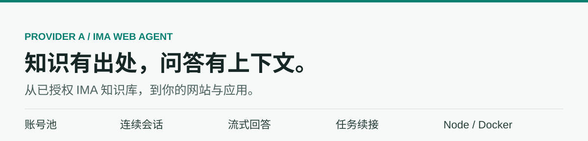
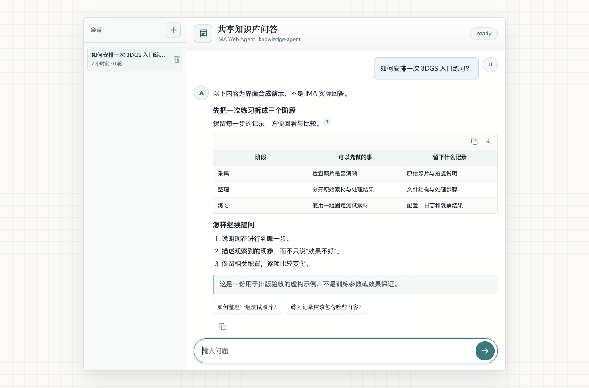
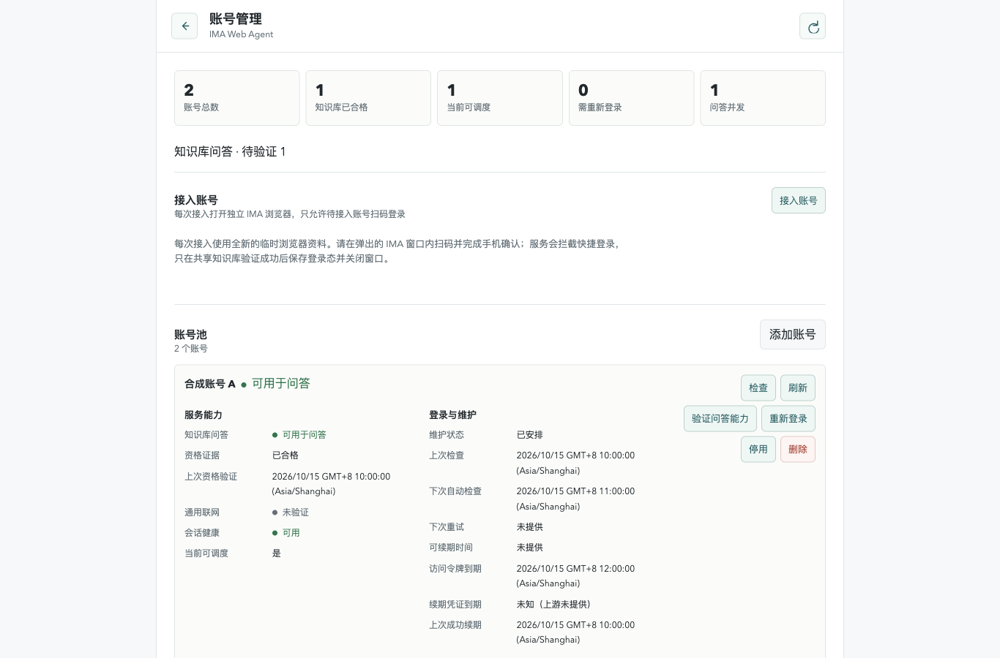
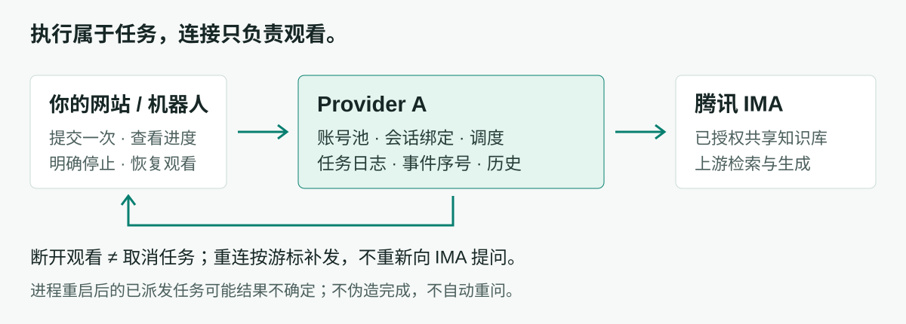

# IMA QA Web Agent



**把你已获授权的 IMA 共享知识库，接成网站和应用可以调用的问答服务。**

内置问答页、嵌入页和账号管理后台；提供连续会话、流式回答与可断线续接的持久任务。使用 IMA 网页端能力，不需要 IMA OpenAPI、MIMO Key 或本地知识索引。

[开始部署](#开始部署) · [账号接入](#账号接入) · [接入自己的网站](#接入自己的网站) · [更新日志](CHANGELOG.md) · [稳定 Release](https://github.com/19Chris19/ima-qa-web-agent/releases/latest)

## 先看体验



**合成演示，不是真实 IMA 回答。** 截图取自 2026-10-15 的源码基线（见资产说明），账号、正文与来源均为虚构测试数据；不展示用户历史或登录态。来源和生成方式见 [资产说明](assets/readme/ASSETS.md)。

| 使用者 | 入口与作用 |
| --- | --- |
| 普通用户 | `/`：提问、切换会话、阅读回答与继续追问 |
| 网站开发者 | `/embed.html`：嵌入通用问答页；或由自己的 BFF 调用接口 |
| 服务维护者 | `/admin.html`：接入账号、查看能力与维护时间，需要独立管理员凭证 |



## 服务如何工作



```text
用户 → 内置问答页 / 你的网站 BFF / 机器人后端
                         ↓
           Provider A：账号池 · 会话 · 持久任务
                         ↓
                已授权 IMA 共享知识库
```

- **会话有上下文。** 同一会话继续使用已绑定的 IMA 账号和 session；其他访客不能读取它。不为抢占空闲账号偷偷迁移上下文。
- **回答不依赖观看连接。** 先持久化任务，再调用 IMA；订阅断线后按事件游标继续接收同一任务，不自动重问。明确停止才发起取消，关闭 HTTP 不等于腾讯确认停止生成。
- **正文忠实传递。** 保留空格、换行和顺序；流式、完成态与历史统一安全 GFM 渲染。只有明确的上游成功终态才显示完成，缺失终态如实记录。
- **并发来自可调度账号。** 单账号默认同时执行 1 条；多个用户与会话排队共享容量。账号总数、可调度槽数和忙碌数不是同一指标。
- **扫码是维护，不是每次问答的前提。** 维护电脑的独立浏览器完成官方登录；验证后凭证加密存服务端，运行期不必保持浏览器窗口。

新任务路径在持续收到有效上游事件时默认不设执行总时限，仍保留连接等待、上游静默与大小保护。服务重启后未派发任务可以恢复排队；已派发但结果未确认的任务标记为不确定，**不自动重问**。见 [持久任务与恢复边界](docs/DURABLE_QA_TASKS.md)。

## 开始部署

**新安装推荐 Agent 引导 + Docker。** 同一个版本同时支持 Node 与 Docker，不分“本地版”和“容器版”。从 [最新稳定 Release](https://github.com/19Chris19/ima-qa-web-agent/releases/latest) 下载完整源码或检出固定 tag；使用该版本锁文件及镜像清单，不部署浮动 main。

| 当前稳定版本 | 配套与发布说明 |
| --- | --- |
| **Provider A v0.7.0** | [版本说明](docs/releases/v0.7.0.md) · [镜像与配套发布](docs/PAIRED_RELEASES.md) |
| **知天下 v0.5.0** | [独立品牌网站](https://github.com/19Chris19/explorer-ai-qa-demo)的固定配套，不附送在本项目中 |

先提供**官方知识库分享链接**，无需手工寻找数字 ID。缺少 Docker 时，Agent 应说明安装内容并取得许可，从官方渠道安装；不绕过系统授权或覆盖已有安装。

把仓库链接、分享链接和下面提示词交给具备终端能力的 Agent：

> 请部署此仓库最新已发布稳定版本，先读 README 与 docs/AGENT_DEPLOYMENT.md。目标知识库为我提供的官方分享链接。先检查系统、架构、Docker/Compose、端口和已有安装；缺少依赖时解释并等待安装授权，使用官方渠道。用仓库引导工具完成配置及扫码通路，不临时拼接凭证，不覆盖账号、会话或卷，不开放管理及内部接口。若目标为无桌面 Linux，先确认维护电脑及 SSH。打开官方 IMA 窗口前提醒我接入账号须加入目标知识库；需要扫码、手机确认、加入或系统授权时暂停。继续验证后分别报告安装、连通、账号就绪与问答验收状态，以及版本、地址、未通过项和恢复方法。真实问答先说明并取得授权，普通检查不自动提问。

在已下载的固定版本目录中，Mac / Linux 使用：

```sh
sh onboard.sh doctor
sh onboard.sh install --share-url '你的官方 IMA 分享链接' --project my-ima-qa --port 3117
sh onboard.sh check
```

Windows 使用对应的 `onboard.ps1`。桌面引导器准备匹配版本的专用 Chromium；Linux 服务端不安装桌面浏览器，由维护电脑经 SSH 扫码。默认管理入口仅监听本机。完整流程见 [Agent 部署说明](docs/AGENT_DEPLOYMENT.md)；已有 Node 安装走 [高级部署](docs/DEPLOYMENT.md)，**不要重新初始化凭证**。

## 账号接入

1. 打开工具报告的 `/admin.html`，使用本安装的管理员凭证登录；不要把凭证发到聊天或提交到 Git。
2. 点击“接入账号”，在独立官方 IMA 窗口人工扫码、手机确认；账号须已加入目标共享知识库。
3. 未加入时在官方页面人工处理，再继续验证。网络故障不等同于没有权限，创建 session 成功也不等同于授权通过。
4. 授权通过后加密保存登录态，并保持待验证停用；已明确告知的一次问答验证成功后才启用调度。CLI 接入不自动提问。

同一登录身份会去重；重新登录误扫另一个账号时，可显式选择“作为新账号接入”，不覆盖原账号。失败、取消和超时有独立状态，维护时间未知就如实显示未知。见 [账号接入规则](docs/ACCOUNT_ENROLLMENT.md) 与 [后台维护](docs/ADMIN_OPERATIONS.md)。

## 接入自己的网站

**直接嵌入通用问答页**：

```html
<iframe src="/embed.html" title="共享知识库问答"
  style="width:100%;height:640px;border:0"></iframe>
```

外站嵌入须按 [部署文档](docs/DEPLOYMENT.md) 配置精确来源、CSP 与反代；不要把默认示例直接当作公网生产配置。

**自定义页面**：浏览器只访问自己的网站 BFF，BFF 再调用 Provider。普通、内部服务和管理员凭证保持分离；`/internal/` 不经公网反代开放。新版内置页与网站任务接入须校验 `durable_qa_tasks_v1`，不能用健康检查代替协议兼容判断。

| 接入资源 | 用途 |
| --- | --- |
| [网页 BFF 合同](docs/WEB_BFF_CONTRACT.md) | 鉴权、能力声明、会话与服务端接入 |
| [持久任务 API](docs/DURABLE_QA_TASKS.md) | 幂等提交、状态、事件游标与显式取消 |
| [最小网站示例](examples/web-bff/README.md) | 默认合成模式，无需账号 |
| [机器人适配示例](examples/bot-adapter/README.md) | 用户到会话映射；不是完整微信机器人 |
| [通用问答体验](docs/QA_EXPERIENCE.md) | 紧凑输入、停止、滚动跟随、复制与划词复制 |
| [问答展示合同](docs/chat-presentation-v1.md) | 来源引用、表格工具和明确的上游过程信息 |

Provider A 是独立服务，知天下是调用它的专业网站案例，不是 fork。完整网站部署应从网站仓库进入，让它选择匹配的 Provider；两仓不共享账号目录或运行数据。公开项目不提供维护者的账号池，也不包含知天下 Logo、导航或品牌动效。

## 升级与验收边界

**合并 PR、发布 Release 和更新运行服务是三件事。** 已有安装不会自动升级；升级前备份配置和数据、停止接收并排空任务，再切换固定代码或镜像。回退保留新增会话与账号；JSONL v2 数据须使用兼容读写版本，不能直接交给旧版。见 [版本升级](docs/PRERELEASE_UPGRADES.md) 与 [完整主机迁移](docs/HOST_MIGRATION.md)。

| 已有证据 | 仍需验证 |
| --- | --- |
| macOS 既有安装、Linux ARM64 / AMD64 容器合成链路；既有授权账号的真实问答和历史恢复记录 | 全新账号完整扫码、续期与长期运行 |
| 当前版本正确性与可靠性测试，见 [配套验收](docs/PAIRED_ACCEPTANCE_20261014.md) | v0.6.4 补丁后的独立真实 IMA 复验 |
| Windows 引导与 Linux SSH 维护实现及合成测试 | Windows 真机、远程 Linux 全流程；手机真机与办公软件粘贴 |

不要把镜像能启动、容量大于零或合成截图当作真实问答成功。当前依赖 IMA 网页协议，**不是腾讯官方稳定 OpenAPI 承诺**；上游登录、权限与协议变化仍需维护。没有已验证的 Web Agent 生图合同，不宣称支持 IMA 生图。

手机端最新的引用触控和输入栏改动见 [手机交互说明](docs/MOBILE_INTERACTIONS.md)。截图不代表 v0.6.4 的逐像素验收；真机软键盘和安全区仍须单独测试。

## 文档与开发

[完整部署](docs/DEPLOYMENT.md) · [部署后验收](docs/ACCEPTANCE_TESTING.md) · [安装验收](docs/ONBOARDING_ACCEPTANCE.md) · [来源预览](docs/source-preview.md) · [能力合同目录](docs/IMA_CAPABILITY_CONTRACTS.md) · [更新日志](CHANGELOG.md)

```sh
npm ci
npm test
```

公开仓库仅交付源码、模板与合成资产；`.env`、`runtime/`、账号密钥、cookie、浏览器 profile 和真实历史始终保持私有。并发演练和真实问答探针会调用 IMA，须事先取得授权，不用于健康轮询。
