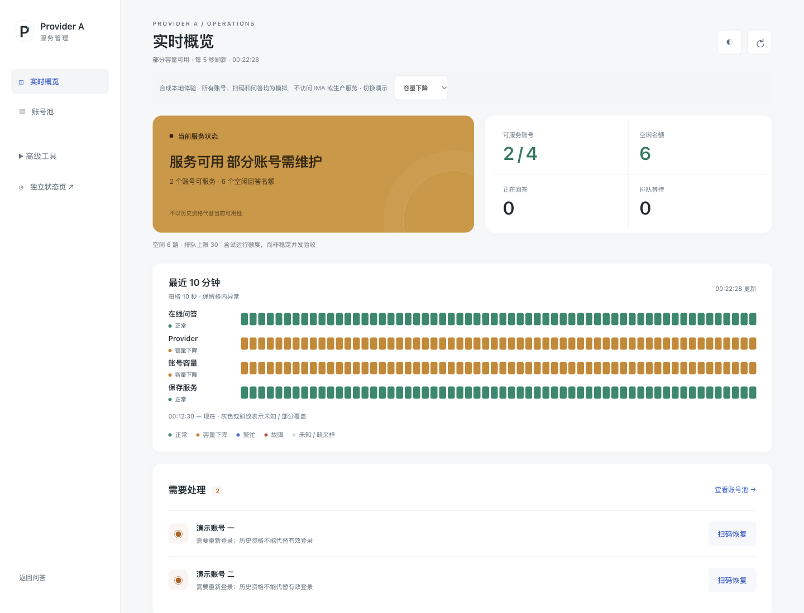
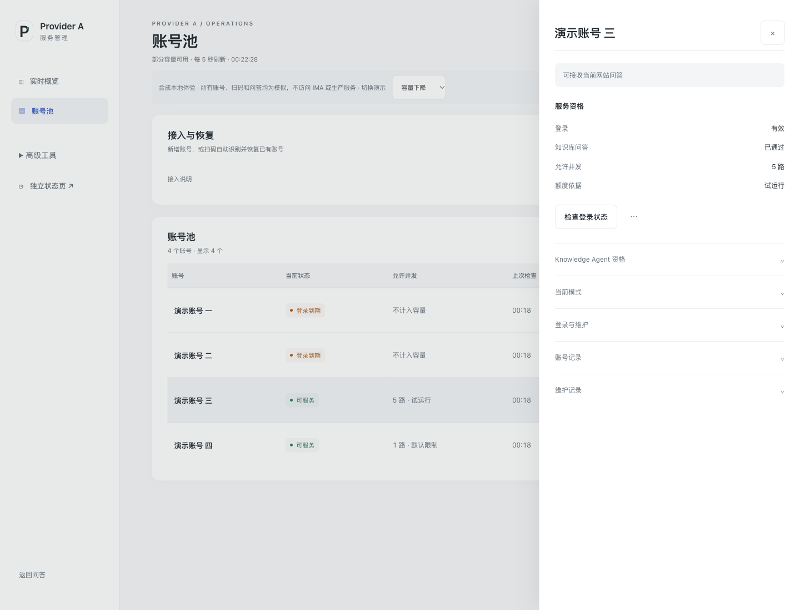
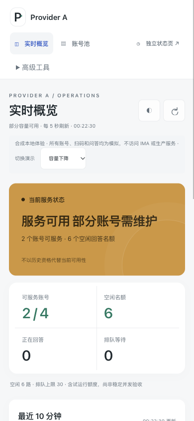
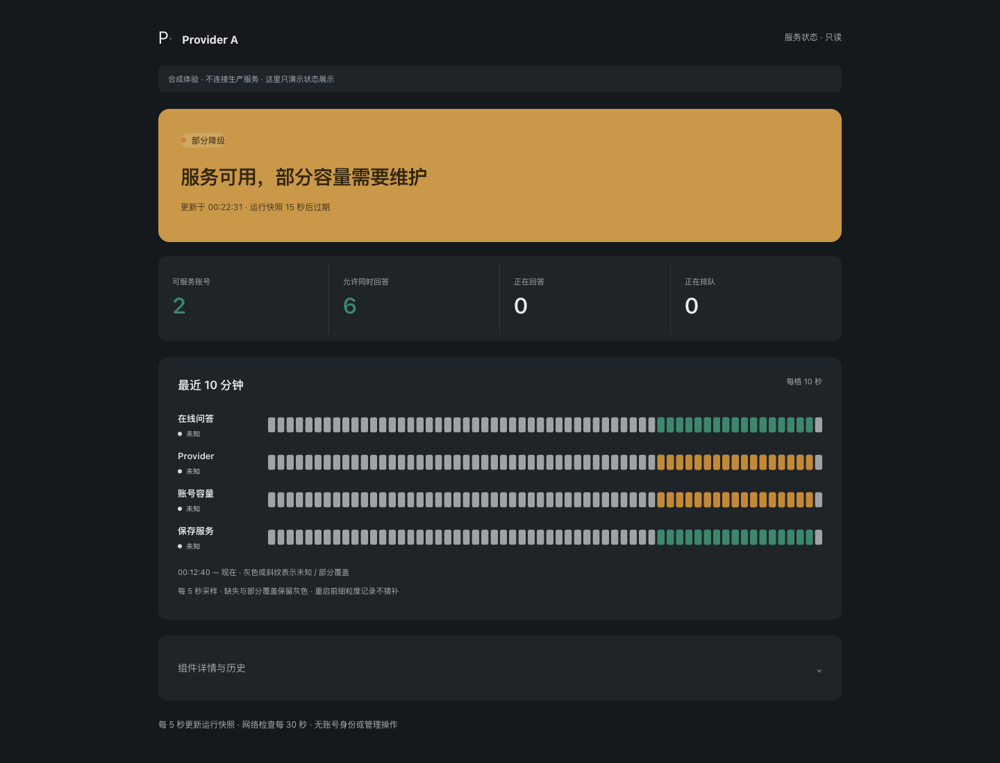

# 本地验收报告

日期：2026-11-10 至 2026-11-11（Asia/Shanghai）。基线 `feced06`，Node 22.23.3。生产服务、登录态、账号、密钥、历史及 Air 未修改，真实 IMA 请求为 0。本地预览仅使用合成账号和合成状态。

## 实现与验证范围

| 项目 | 结果 |
|---|---|
| 首页顺序与视觉 | 主状态、四计数、10 分钟、待处理账号；精修瓷灰 / 琥珀 / 翡翠，深浅主题 |
| 主导航 | 实时概览、账号池；高级入口折叠，旧功能和报告保留 |
| 账号池 | 搜索、筛选、桌面表格、手机卡片；刷新不清空筛选、抽屉、演练草稿 |
| 抽屉 / 底部面板 | 桌面右侧，390×844 模拟触屏底部；44px 按钮，小叉 / Escape / 遮罩 / 把手关闭，焦点返回 |
| 维护安全 | 单账号最多 1 次确认额度展示，取消不提交，重复点击不重复操作，保存保护不允许启用，命名和身份匹配规则保留 |
| 兼容 | 旧服务缺少新版状态字段时仍可进入原扫码预检；新版明确保存异常则禁用新接入 |
| 监控 | 120 点内存上限、60 格、固定 10 秒边界、缺失及部分覆盖、同格异常保留、时间滚动与重启 |
| 接口权限 | 未认证返回拒绝；固定本机上游，不接受客户端 URL；1.5s 超时、128KiB 上限、1s 短缓存和并发合并；嵌套字段允许列表 |
| 读取副作用 | 多次最近视图读取不启动新采样请求、不读账号文件、不触发维护、不增加分钟历史写入 |
| 原历史 | 30 天保留、分钟覆盖和变化事件，重启不恢复或猜补细采样 |
| 合成状态 | 正常、容量下降、繁忙、入口故障、保存保护、未知、待资格验证 |
| 可访问性 | 浏览器键盘 Tab / Escape、44px 命中、减少动态效果无面板动画，窄屏无横向溢出；未执行完整读屏软件实测 |

独立状态进程实际每 5 秒采样，Provider/网站异常可独立展示。后台同源转发只读取其缓存。真实监控从启用开始采集；仅合成后台为视觉检查预置了明确标注的示意时间窗。

## 测试

最终全仓 **1,047 项通过、5 项跳过、0 失败**（共 1,052 项），结果写入 `validation.json`；受影响的 operations 测试 40 项通过，另与旧迁移后台兼容测试联合 41 项通过。全仓通过不替代下面的未验收项。

5 项跳过，均未计作通过：

1. 缺少配套 executor 的跨组件 durable HTTP 联合测试。
2. 一项 365 秒真实时钟任务恢复测试。
3. 两项缺少知天下配套解析器路径的测试。
4. 另一项 365 秒真实时钟 / 队列 / 原生 HTTP 测试。

命令：`node --test --test-concurrency=1`，并显式设置现有后台兼容检查根目录。所有账号、网络上游和任务为临时目录或本地模拟。未运行真实问答、扫码、续期、原文读取或维护。

浏览器：Ego Lite，桌面 1440×1100 / 日常桌面窗口，390×844 模拟触屏。已验证五类主状态映射、搜索筛选保留、单账号额度确认取消、桌面与手机详情、真实触摸事件下拉关闭、焦点返回、减少动态效果。iOS Safari、Android Chrome 真机以及读屏软件仍待验收。

## 30 轮合成流对照

固定每轮 24 个 delta；两组均读取概览、异步写分钟记录，新组再执行最近窗口与一次状态 HTTP 读取。虚拟采样时钟每轮前进 5 秒；不是 30 次真实问答，也不是生产 SLA。基线使用独立旧候选 `feced06` 的实现。后台其他负载可能造成波动，单次对照不证明所有差值的因果。

| 指标 | 基线 | 新候选 |
|---|---:|---:|
| 首段 P95 | 9.33 ms | 25.99 ms |
| 相邻事件 P95 | 6.76 ms | 7.26 ms |
| 概览请求 P95 | 3.93 ms | 10.25 ms |
| 事件循环 P95 | 1.79 ms | 2.39 ms |
| 累计 CPU | 479 ms | 521 ms |
| 进程 RSS 峰值 | 100.25 MiB | 99.92 MiB |
| 分钟记录写入 | 4 | 4 |
| 最近视图响应峰值 | 无该视图 | 38,670 bytes |

事件间隔增量约 0.50ms，首段增量约 16.66ms；不能表述为零开销或“首段完全不受影响”。最近窗口本身不落盘，分钟写入次数未增加。此压力回放每轮读取一次状态，频率高于真实页面每 5 秒读取。

另有 300 轮、约 39 秒的短期资源回放，限制合成会话最多 1 个、6 轮：最近采样始终不超过 120 点，响应峰值 38,729 bytes；RSS 峰值 120.52 MiB。第 150 到 300 轮强制 GC 后 heap 约 14.17→14.47 MiB，RSS 约 119.22→120.52 MiB。结果没有显示随采样点数无限增长，但仍有小幅增长；该短窗口不足以证明长期无泄漏，长时间稳定性留待后续。浏览器与独立监控常驻进程的生产资源表现不由此合并进程合成测试代替。

原始数值见 `performance-before.json`、`performance-after.json` 和 `performance-stability.json`。

## 截图（均为合成资料）

## 尚未执行

- 真实账号维护、保存核对、扫码及资格问答。
- 生产独立监控和管理员转发的联合部署验收。
- iOS Safari / Android Chrome 真机、软键盘和读屏实测。
- 小时 / 跨天稳定性、与 3DGS 重建同时运行的生产负载对照。
- GitHub 推送、PR、合并、发版和正式上线。

原候选、原历史与生产登录态均保留。正式部署须另行确认并排空备份；本地预览不可被当作生产容量或恢复证据。
